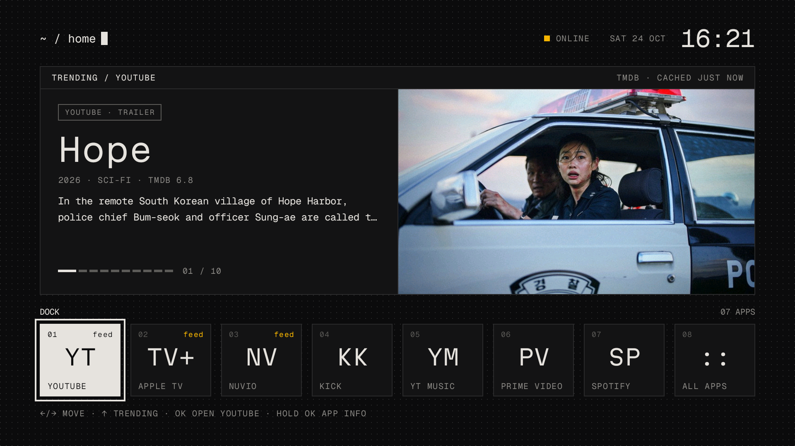
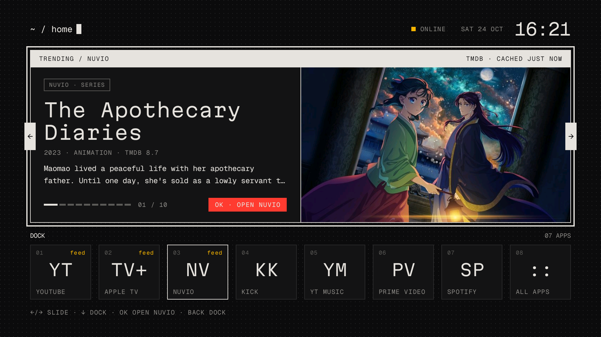
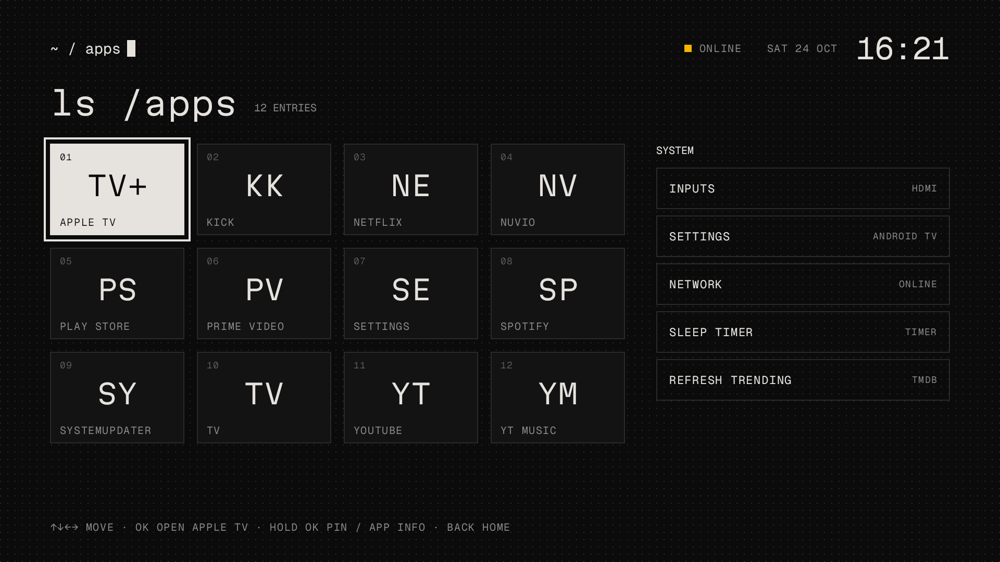
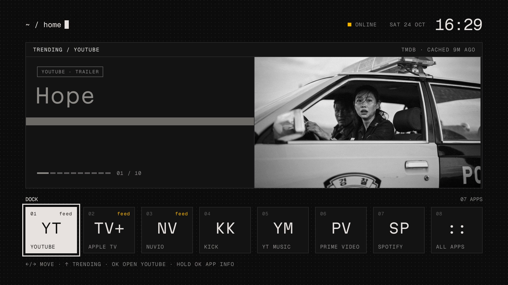
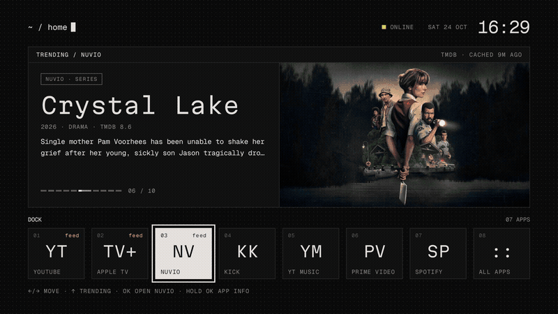

# Terminal home for Android TV

A terminal-style home screen for Android TV and Google TV. I built it for a Grundig 65 GJQ 9200
(Google TV, Android 14). It replaces the stock home screen, which shows ads, with one dark screen:

- **Header**: `~ / home` with a block cursor, network status, date and clock.
- **Trending card**: trending titles from TMDB for the focused dock app. YouTube shows trailers,
  Nuvio shows TMDB trending, Apple TV shows Apple TV+ series, Spotify shows new albums picked for you (see
  Build), and the other apps show a mixed feed.
  It changes slide every 8 seconds. OK opens the title.
- **Dock**: eight tiles for YouTube, Apple TV, Nuvio, Spotify, YT Music, Prime Video, Kick and All apps.
  The four apps with a feed come first; a pinned app goes in at slot 05.
  Hold OK on a tile to open its App info.
- **All apps** (`ls /apps`): every installed app in a grid, and a SYSTEM list with Inputs, Settings,
  Network, Sleep timer and Refresh trending. Hold OK on an app to pin it to the dock.
- **Remote keys** (`keymap`, the first SYSTEM row): a line drawing of the Grundig remote. Pick a button with the
  D-pad, or press it on the real remote, and give it a tap or hold action: an app, Inputs, Home, Apps, Settings,
  Mute, Sleep or Nothing. LEARN KEY records the button's real keycode. Buttons whose firmware app is disabled
  (Mic, Guide, ECO) show a dashed outline; FIX BROKEN KEYS maps them in one step. The six app keys are blank:
  each shows the name of the app you give it. The mappings need the key helper (InputKeyService) on:
  the KEY HELPER row turns it on when the launcher has WRITE_SECURE_SETTINGS
  (`adb shell pm grant com.gathin.tvhome android.permission.WRITE_SECURE_SETTINGS`).
- **Trending screensaver** (`TrendingDream`): the trending feed full screen. Each picture pans slowly for
  45 seconds while its title, meta line and overview type in, then the next one comes in as 40 dp blocks. OK opens
  the title in its app, Left and Right change the slide, and any other key wakes the TV. From 23:00 to 06:00 the
  picture is dimmer and the panel folded. It uses the feed Home cached, so it keeps running offline. Pick
  "Trending" under Screensaver in the TV's settings, or:
  `adb shell settings put secure screensaver_components com.gathin.tvhome/.TrendingDream`

The look is brutalist: Geist Mono and Martian Mono, square corners, no shadows or gradients, and
short stepped animations only.

## Screenshots


Home: the trending card shows the YouTube feed while the YouTube tile has focus.


The trending card with focus: Left and Right change the slide, and OK opens it in Nuvio.


All apps: every installed app, and the SYSTEM list on the right.


A slide change: a short grey glitch frame before the new slide shows.


Focus moves along the dock, the trending card takes focus, and the slides change.

## Build

You need JDK 17 and the Android SDK command-line tools.

1. Get a TMDB API key (v3 key or v4 read token) at https://www.themoviedb.org/settings/api.
2. Make `keys.properties` in the project root. Git ignores this file; do not commit it.

   ```properties
   TMDB_API_KEY=your-key-here
   SPOTIFY_CLIENT_ID=
   SPOTIFY_CLIENT_SECRET=
   SPOTIFY_REFRESH_TOKEN=
   ```

   Without a key the launcher works, but it has no trending card. The Spotify keys are optional: the client id
   and secret come from an app at https://developer.spotify.com/dashboard and give the Spotify tile a feed of new
   releases. Without them, the Spotify tile shows the mixed feed.

   For a personal Spotify feed (new releases from your top and followed artists, then albums to jump back into),
   add `http://127.0.0.1:8888/callback` as a redirect URI in the Spotify app, then sign in once:

   ```sh
   /usr/bin/python3 tools/spotify-login.py
   ```

   It writes `SPOTIFY_REFRESH_TOKEN` into `keys.properties`. The token is built into your local APK, and it
   gives read access to your Spotify listening data: do not share that APK.
3. Build:

   ```sh
   export ANDROID_HOME=/path/to/android-sdk
   ./gradlew assembleRelease
   ```

   The APK is `app/build/outputs/apk/release/app-release.apk`. It is signed with the debug key,
   for sideloading only.

## Install

Turn on developer options and network debugging on the TV, then:

```sh
adb connect <tv-ip>:5555
adb install -r app/build/outputs/apk/release/app-release.apk
adb shell am start -a android.intent.action.MAIN -c android.intent.category.HOME
```

The first time, the TV asks which app to use as home. Choose this launcher.

`build-and-install.sh` and `build-and-install.ps1` come from the upstream project. They need the
upstream `tools/` folder, which is not in this repository, so use the adb commands above instead.

## Classic home

To get the upstream home screen back, set `terminal_home` to `false` in
`app/src/main/res/values/config.xml` and build again.

## Credits

This is a fork of the launcher in [CleanYourTV](https://github.com/Gathin23/cleanyourtv) by Gathin
(MIT License). The terminal home, the trending card and the dock are new here. The rest of the
launcher, including the key handling, app launching and settings, comes from upstream.

Trending data and images come from [TMDB](https://www.themoviedb.org). This product uses the TMDB
API but is not endorsed or certified by TMDB.

Licenses: MIT for the code (see `LICENSE`). The fonts are under the SIL Open Font License 1.1
(`FONT-LICENSE-OFL.txt`, `FONT-LICENSE-OFL-MONO.txt`).
